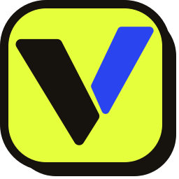
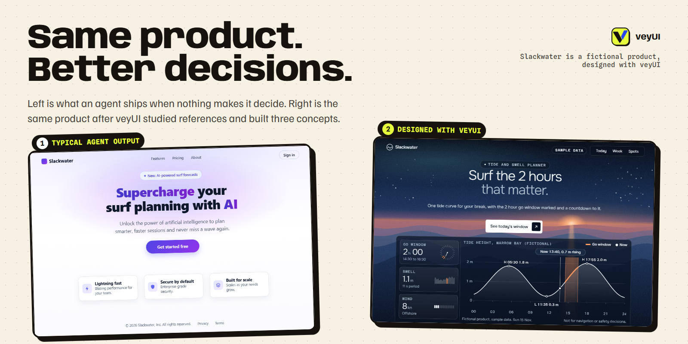
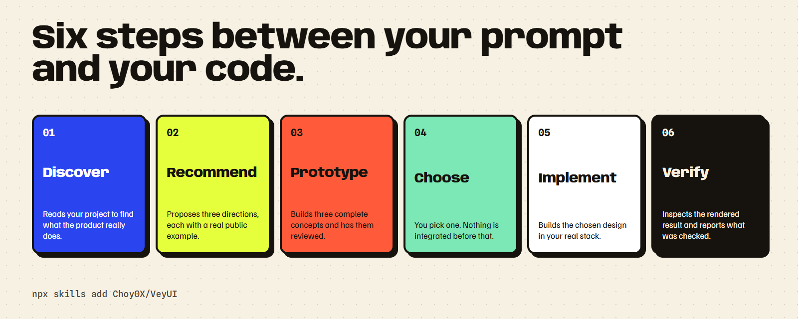

<p align="center">
  
</p>

<h1 align="center">veyUI</h1>

<p align="center">
  <b>Design-led UI/UX skill for AI coding agents.</b><br>
  Stop shipping generic, AI-looking interfaces. veyUI researches references, builds three real concepts for you to choose from, then implements and verifies the winner.
</p>

<p align="center">
  <a href="docs/installation.md"></a>
  <a href="LICENSE"></a>
  <a href="https://agentskills.io"></a>
  <a href="https://choy0x.github.io/VeyUI/"></a>
</p>

<p align="center">
  <a href="https://choy0x.github.io/VeyUI/">Website</a> |
  <a href="docs/installation.md">Install</a> |
  <a href="docs/platforms.md">Platforms</a> |
  <a href="docs/usage.md">Usage</a> |
  <a href="docs/how-it-works.md">How it works</a> |
  <a href="docs/faq.md">FAQ</a>
</p>





## Install

```sh
npx skills add Choy0X/VeyUI
```

That installs veyUI for the agents on your machine (Claude Code, Codex, Cursor, Gemini CLI, GitHub Copilot, Windsurf, OpenCode, Cline and many more). Then start a new session and ask:

> Use veyUI to redesign this landing page.

Other ways to install:

| Method | Command |
|---|---|
| One agent only | `npx skills add Choy0X/VeyUI -a claude-code` |
| Claude Code plugin | `/plugin marketplace add Choy0X/VeyUI` then `/plugin install veyui@veyui` |
| Gemini CLI extension | `gemini extensions install https://github.com/Choy0X/VeyUI` |
| Offline, any platform | `git clone https://github.com/Choy0X/VeyUI && cd VeyUI && python install.py --all` |
| Manual | Copy `skills/veyui/` into your agent's skills folder (see [platforms](docs/platforms.md)) |

## What it does

Most AI-generated interfaces look the same: centered hero, three feature cards, purple gradient. veyUI gives your agent a design process and the evidence to back it.

1. **Discover.** Reads your project to find what the product really does, then turns capabilities into specific, honest copy.
2. **Recommend.** Proposes project-fit reference directions, each with a verified public example and a clear tradeoff.
3. **Prototype.** Builds **three distinct, complete concepts**, hosts them locally and reviews them with independent critique.
4. **Choose.** You pick. Nothing is integrated before that.
5. **Implement.** Builds the chosen design in your real stack, web, mobile or desktop.
6. **Verify.** Inspects the rendered result in a real browser or runtime, and reports what was and was not checked.

Use it for landing pages, marketing sites, product apps, dashboards, native screens, design systems, motion and UX audits.

## What is inside

| | |
|---|---|
| Reviewed screens | 583 pre-extracted UI-state descriptions (268 mobile, 195 desktop, 120 web), retrievable offline |
| Reference catalog | 384 records with evidence levels and honest rights notes |
| Pattern atlas | 200 original pattern cards |
| Decision guides and flows | 19 guides and 8 documented flows |
| Design modules | 37 reference modules and 8 templates (art direction, motion, components, copy, audit, release checks) |
| Web engine | A pinned copy of Taste Skill: layout recipes, effects, scenes, copy lint and browser checks |
| Concept studio | Scripts that scaffold, host and check three-concept reviews |

Numbers come from the data files in `skills/veyui/data/`. Run `python skills/veyui/scripts/design_library.py stats` to see them yourself.

## Works with your agent

veyUI follows the open [Agent Skills](https://agentskills.io/specification) format, so one folder works across tools. The `skills` CLI places it in the right directory for each agent.

| Agent | Install | Invoke |
|---|---|---|
| Claude Code | `npx skills add Choy0X/VeyUI -a claude-code` or the plugin | `/veyui` or ask in plain language |
| Codex | `npx skills add Choy0X/VeyUI -a codex` | `$veyui` |
| Cursor | `npx skills add Choy0X/VeyUI -a cursor` | Ask in plain language |
| Gemini CLI | `-a gemini-cli` or the extension | Ask in plain language |
| GitHub Copilot | `-a github-copilot` | Ask in plain language |
| Windsurf, Cline, OpenCode, Amp, Roo, Kiro, Goose, Trae, Continue, Junie, Qwen Code, OpenHands, Augment | `-a <agent>` | Ask in plain language |
| Anything else | Point it at `skills/veyui/SKILL.md` or use `AGENTS.md` | Ask in plain language |

Full paths per agent are in [docs/platforms.md](docs/platforms.md). Run `python install.py --list` to print them.

## Requirements

- Python 3.10+ for the offline library and concept scaffolding.
- Node 22+ and Chrome, Edge or Chromium for the bundled web checks.
- A way to run and preview your project. veyUI does not provide hosting or a browser.

## Honest limits

veyUI enforces an evidence-based workflow. It cannot guarantee that every model produces excellent design. Final output still needs real rendered inspection, working interactions and your choice. A passing check or a reference count is not visual approval. Reference images for 31 concept studies are not distributed, because their redistribution rights are unverified. Those studies are text only.

## Credits

veyUI's web construction engine is a pinned, unmodified copy of **[Taste Skill](https://github.com/Leonxlnx/taste-skill) by [Leonxlnx](https://github.com/Leonxlnx)** (MIT), commit `f6b76575f949707b4e3c37cd86cb44b0b98643e8`. It supplies the layout recipes, effects, scenes, copy linting and browser checks that veyUI drives. Thank you to Leonxlnx for building and open-sourcing it.

veyUI adds the offline reference library, the discovery and recommendation workflow, the three-concept studio with independent review, the evidence checks, and the multi-platform packaging. veyUI is an independent project and is not endorsed by the Taste Skill author.

Full attribution and item-level asset licenses are in [THIRD-PARTY-NOTICES.md](THIRD-PARTY-NOTICES.md).

## Contributing

Issues and pull requests are welcome. Start with [CONTRIBUTING.md](CONTRIBUTING.md). Security reports go through [SECURITY.md](SECURITY.md).

## License

[MIT](LICENSE) for veyUI. Vendored third-party material keeps its own license, listed in [THIRD-PARTY-NOTICES.md](THIRD-PARTY-NOTICES.md).
